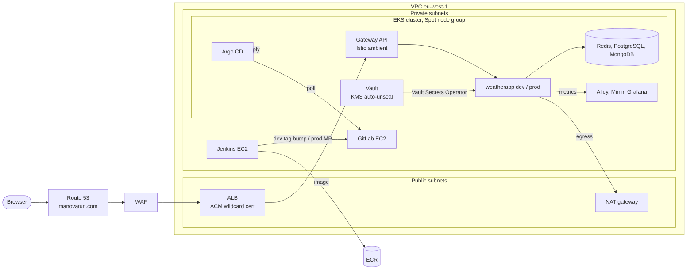

# eks-platform-infra

Terragrunt-managed AWS infrastructure for a single-cluster EKS platform: layered Terraform for network, persistent data, CI/CD hosts and
the EKS cluster, plus the scripts and runbook that build and destroy it on demand. Workloads are delivered by Argo CD from the companion
repository [eks-platform-gitops](https://github.com/manoVaturi/eks-platform-gitops); the application is
[weather-service](https://github.com/manoVaturi/weather-service).

History: V1 (Terraform modules, GitLab, Jenkins, Argo CD, WAF) was fully provisioned and served live production traffic at
`manovaturi.com`. V2, this repository, is the Terragrunt, Vault and Istio evolution of it. It was fully provisioned on AWS, validated
via Terragrunt and Helm, and tested in a staging cluster environment. It was subsequently torn down to avoid sustained AWS
infrastructure costs.

## Architecture



### Request and deployment lifecycle

1. A browser resolves `weather.manovaturi.com` in Route 53 (records maintained by ExternalDNS).
2. The request passes the regional WAF web ACL (AWS managed IP-reputation and known-bad-inputs rule groups, plus a rate limit) and terminates TLS on the ALB.
3. The AWS Load Balancer Controller routes by host header through Gateway API resources to the pod behind the Istio ambient data plane.
4. The Flask app checks Redis, calls Open-Meteo through the NAT gateway on a miss, and records the result in PostgreSQL (history) and MongoDB (snapshots).
5. Alloy scrapes the app, cAdvisor and kube-state-metrics, and remote-writes to Mimir. Grafana alert rules post to Slack.
6. A merge to `main` of weather-service triggers Jenkins: test, build, Trivy scan, push to ECR, and a one-line image tag bump in the gitops repository for dev. A `vX.Y.Z` tag opens a merge request for prod instead.
7. Argo CD polls the gitops repository and applies the change. Nothing deploys to the cluster from CI.

## Key architectural decisions

| Decision | Reason |
| --- | --- |
| Terragrunt over plain Terraform layers | Backend, provider and version blocks are generated from `terraform/_shared/*.tpl`, and cross-layer values come from `dependency` blocks, so layers carry no copy-pasted boilerplate. |
| Persistent and ephemeral layers kept apart | `10-network` (NAT off), `20-persistent` and `35-gitlab-data` hold disks, DNS, WAF, KMS and ECR. `40-eks` and `45-gitlab-server` are destroyed after each session. Idle cost is about 14 USD per month; a working hour adds about 0.35 USD. |
| Single Spot managed node group | Several instance types improve Spot availability. The node is pinned to `eu-west-1a` because the Vault data volume is a zonal EBS volume. |
| EKS Pod Identity by default, IRSA for Vault | Pod Identity trust policies do not reference the cluster OIDC provider, so they survive cluster re-creation. Vault keeps IRSA for its KMS auto-unseal role. |
| Vault with KMS auto-unseal on a persistent volume | Secrets survive the nightly cluster destroy. Vault Secrets Operator syncs `kv/*` into Kubernetes Secrets, so no secret value lives in Git. |
| Argo CD pull-based delivery, Jenkins edits one line | CI has no cluster credentials. Jenkins only writes the image tag in the gitops repository; prod promotion is a reviewed merge request. |
| GitLab and Jenkins on EC2, reachable only from `allowed_cidrs` | Source of truth and CI stay outside the cluster they deploy, so a cluster rebuild does not take the pipeline with it. |
| Istio ambient mode | Mutual TLS and L4 policy without sidecars, which keeps memory use low on a one-node cluster. |

## Repository layout

```text
.
├── Jenkinsfile                 pipeline for this repo: format, validate, tflint, Trivy config scan (report-only), plan
├── docs/
│   ├── runbook.md              bootstrap, daily start and stop, Vault init, troubleshooting, alerts
│   ├── architecture.md         layer dependencies and the V1 to V2 evolution
│   └── roadmap.md              known constraints and production hardening
├── scripts/                    up.sh, down.sh, apply.sh, status.sh, vault-bootstrap.sh, fwd.sh, check.sh
└── terraform/
    ├── root.hcl                Terragrunt root: S3 backend, generated provider and version files
    ├── _shared/                templates rendered into every layer
    ├── 00-bootstrap/           Terraform state bucket (local state, applied once)
    ├── 10-network/             VPC, subnets, optional NAT gateway
    ├── 20-persistent/          ECR, KMS, WAF, ACM certificate, Vault data volume, budget alarm
    ├── 30-cicd/                Jenkins EC2, ALB listener rules, DNS, snapshot policy
    ├── 32-ci-plan/             IAM role assumed by the Jenkins plan stage
    ├── 35-gitlab-data/         GitLab data volume, ALB and DNS
    ├── 40-eks/                 EKS cluster, Spot node group, Pod Identity and IRSA roles
    └── 45-gitlab-server/       GitLab EC2 instance
```

## Deploy

Full procedure with every command: [docs/runbook.md](docs/runbook.md). Condensed:

```bash
aws sts get-caller-identity
(cd terraform/00-bootstrap && terraform init && terraform apply)     # once
scripts/apply.sh 10-network -var enable_nat_gateway=true
scripts/apply.sh 20-persistent
scripts/apply.sh 30-cicd -var edge_enabled=true
scripts/apply.sh 35-gitlab-data -var edge_enabled=true
scripts/apply.sh 45-gitlab-server
scripts/apply.sh 40-eks
aws eks update-kubeconfig --name weatherapp --region eu-west-1
```

Then bootstrap Argo CD and the root application from eks-platform-gitops, and initialise Vault with `scripts/vault-bootstrap.sh`.
Tear down with `scripts/down.sh`; the manual sequence is in the runbook.

Placeholders in committed files: `<AWS_ACCOUNT_ID>`, `<CERT_ID>`, `<WEB_ACL_ID>`, `<KMS_KEY_ID>`. In eks-platform-gitops: `<VPC_ID>`, `<VAULT_VOLUME_ID>`. Operator IP ranges go in untracked
`terraform.tfvars`; see `example.tfvars` in `30-cicd` and `40-eks`.

## Verification

```bash
terraform -chdir=terraform/40-eks validate
scripts/check.sh                       # fmt, validate, tflint across layers
kubectl -n argocd get applications     # every Application Synced and Healthy
curl -s https://weather.manovaturi.com/healthz
```

Argo CD, Grafana and Mimir are reached by `kubectl port-forward`; commands are in the runbook.

## Known constraints and hardening roadmap

See [docs/roadmap.md](docs/roadmap.md).
